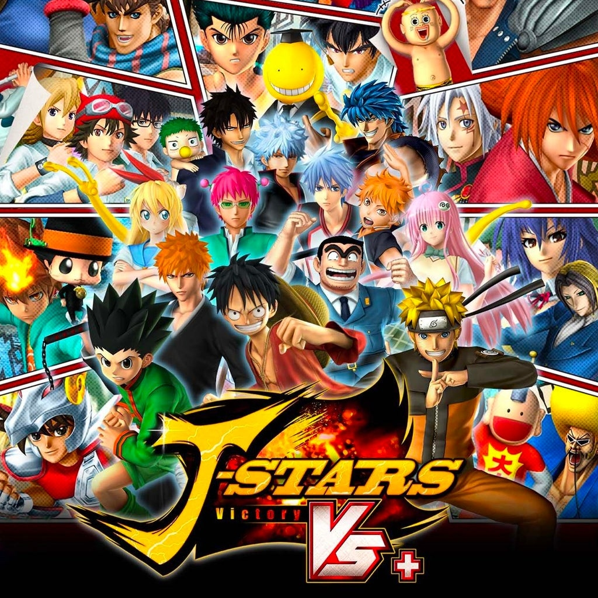

# J-Stars Victory VS+ PC

[](https://microsoft.com/windows)
[](https://vulkan.org)
[](https://github.com/krixsan/J-Stars-Victory-VS-PC/releases)
[](https://github.com/krixsan/J-Stars-Victory-VS-PC/releases)
[](https://github.com/krixsan/J-Stars-Victory-VS-PC/releases/tag/v1.5.0)
[](LICENSE)

<p align="center">
  
</p>

<p align="center">
  <a href="https://recomplauncher.com"><picture><source media="(prefers-color-scheme: dark)" srcset="https://recomplauncher.com/assets/press/launcher/badge-light.svg"></picture></a>
</p>

> **[Download Portable Release (v1.5.0)](https://github.com/krixsan/J-Stars-Victory-VS-PC/releases/latest)** | **[Changelog](CHANGELOG.md)** | **[SHA-256 Checksums](CHECKSUMS.txt)**  
> Standalone Windows x86-64 native wrapper & Vulkan runtime portal for **J-Stars Victory VS+** (`CUSA01593` US, `CUSA01887` EU, `CUSA01661` JP).  
> **Zero source code and zero copyrighted PS4 binaries, firmware modules, keys, or game archives are distributed in this repository.**

---

## Architecture & How It Works (Without Source Code)

Because the PlayStation 4 runs on an **AMD Jaguar x86-64** CPU, Windows executes the game's decrypted ELF/PRX machine code natively on host CPU cores—**no CPU emulation or JIT binary translation is required**.

| Layer | Implementation Details |
| :--- | :--- |
| **Executable & Module Loader** | `jstars_prepare.exe` links `eboot.bin` and `sce_module/*.prx` into `boot-linked.bin` in under `0.2` seconds on first boot; `jstars_pc.exe` maps guest segments directly on Windows x64 |
| **Graphics Translation** | PS4 GNM GPU commands are translated live onto **Vulkan 1.3+** with dynamic state, async background shader worker threads, and crash-proof per-draw fallback skipping |
| **Low-Latency Frame Pacing** | Dedicated **30 FPS Console Timing (`1.0x`)** via waitable timers paired with **NVIDIA Reflex + Boost** (`VK_NV_low_latency2`) and **AMD Anti-Lag 2** (`VK_AMD_anti_lag`), plus optional **AMD FSR 3.1 Frame Generation (`60 FPS Smooth`)** |
| **Audio & Input HLE** | PS4 audio output mapped to **WASAPI** (`Pro Audio` MMCSS scheduling + soft-knee peak limiting); up to **4 local gamepads** via **SDL3**, **XInput**, and direct **Win32 Raw HID DualSense / DualShock 4** (Bluetooth rumble, trigger resistance, RGB lightbar LEDs) |
| **Virtual File System & Saves** | `/app0/` mounts cleanly onto `extracted_game/app0/` with loose-file mod overrides under `user/mods/` and checksum-verified `SAVE-DATA.DAT` profiles under `user/savedata/` |

---

## What's New in v1.5.0

- **30 FPS Console Timing + NVIDIA Reflex / AMD Anti-Lag 2:** Defaults to unmodified **30 FPS console timing (`1.0x` normal speed)** so menus, hitstop, battle timers, and baked 30 Hz character animations run at authentic speed without `v1.0.0`'s 2x speed-up bug. **NVIDIA Reflex + Boost** and **AMD Anti-Lag 2** trim 20–40 ms of swapchain presentation latency; **60 FPS Smooth (AMD FSR 3.1 FrameGen)** stays selectable in `Launcher.exe` for optical-flow GPU interpolation.
- **16x Anisotropic Filtering, RCAS Sharpening & Async Shaders:** Forces up to `16x` anisotropic filtering on 3D arena geometry while explicitly excluding depth/shadow maps and 2D point-sampled UI, and clamps shadow cascade borders cleanly. Async worker threads pre-build Vulkan pipelines without mid-combat hitches, and edge-case shader rejections skip that single draw cleanly instead of crashing.
- **Hor+ Ultrawide FOV (`21:9` & `32:9`):** Expands horizontal camera FOV proportionally at `2560x1080`, `3440x1440`, and `5120x1440` while keeping HUD shadows and framing intact.
- **Built-in Save Manager (`Import`, `Backup Restore` & `Unlock All`):** Validates `SAVE-DATA.DAT` (`200,000` bytes) checksums, detects retail-encrypted PS4 saves before load, saves automatic timestamped backups to `user/save-backups/`, and unlocks all **52 playable/boss characters**, **13 support characters**, and **`999,999` J-Points** in one click.
- **Loose-File Mod Loader (`user/mods/`):** Drop texture, audio, or data replacements mirroring `/app0/` paths (e.g. `user/mods/data/sound/...`) without modifying your base dump.
- **Upgraded `Launcher.exe` & `Insert` / `L3 + R3` Overlay:** Hardware **Auto-Optimize** reads GPU VRAM, system RAM, and monitor dimensions; adds 720p **Safe Mode**, dump integrity validation, custom player name, subtitle language, `Cross`/`Circle` confirm swap, master audio volume, **Infinite Match Timer** toggle, 50 offline trophies (`user/trophies/`), Discord RPC, **`F12`** clean PNG screenshots (`user/screenshots/`), and **7 languages** (`EN`, `ID`, `JA`, `ZH`, `ES`, `PT`, `RU`).

---

## Framerate, Upscaling & Latency Matrix

| Mode / Setting | Simulation Clock | Display Output | Purpose |
| :--- | :--- | :--- | :--- |
| **30 FPS - Original Console Mode (Default)** | `30 Hz` (`1.0x`) | `30 FPS` | Authentic animations, timers, and hitstop + Reflex / Anti-Lag 2 |
| **60 FPS Smooth (`fsr3` FrameGen)** | `30 Hz` (`1.0x`) | `60 FPS` | Optical-flow GPU interpolated frames via AMD FSR 3.1 |
| **Upscaling & Temporal AA** | — | Native / `fsr1` / `fsr3` / `dlss` | Paired with RCAS image sharpness slider (`0.00` – `1.00`, default `0.50`) |
| **Texture Filtering (`anisotropy`)** | — | `0`, `2x`, `4x`, `8x`, `16x` | Default `16x` on 3D arena surfaces (excludes depth/shadow/UI samplers) |

---

## Quick Start & Installation

### System Requirements
- **OS:** Windows 10 (1809+) or Windows 11 (64-bit)
- **CPU:** x86-64 processor with **AVX** support (Intel Core 2nd Gen+ or AMD Ryzen+)
- **GPU:** **Vulkan 1.3+** capable graphics card (NVIDIA GTX 1060 / RTX series, AMD Radeon RX 580 / RX 6000+, or Intel Arc)
- **Memory:** 8 GB RAM minimum (16 GB recommended)

### Step 1 — Download & Verify Portable Release
1. Download **`J-Stars-Victory-VS-PC-portable-windows.zip`** from **[Releases](https://github.com/krixsan/J-Stars-Victory-VS-PC/releases/latest)** (or install via **[RecompLauncher](https://recomplauncher.com)**).
2. Extract to any clean folder (no Python, MSYS2, or external SDKs required).
3. Optional SHA-256 verification (`CHECKSUMS.txt`):
   ```powershell
   Get-FileHash .\J-Stars-Victory-VS-PC-portable-windows.zip -Algorithm SHA256
   ```
   Expected SHA-256: `56284e20c826278647c08ad635dee2ab5483193391bc631d95c52648242227f7`

### Step 2 — Supply Your Decrypted PS4 Game Dump
No PS4 binaries or archives are included. Dump your own legally owned copy of **J-Stars Victory VS+** (`CUSA01593`, `CUSA01887`, or `CUSA01661`):
1. **Jailbroken PS4 (GoldHEN):** Dump the installed title with **ItemzFlow** or **Game Dumper** and copy `app0` contents into `extracted_game/app0/`.
2. **Decrypted `.pkg` (FPKG):** Extract `Image0` with **PkgEditor (LibOrbisPkg)** or `orbis-pub-cmd` into `extracted_game/app0/`.

Expected structure:
```text
extracted_game/app0/
├── eboot.bin
├── sce_module/
│   ├── libc.prx
│   └── libSceFios2.prx
├── sce_sys/
│   ├── icon0.png
│   ├── pic0.png
│   └── param.sfo
└── data/ (and/or .cpk archives)
```

### Step 3 — Configure & Launch
1. Open **`Launcher.exe`** and click **Auto-Optimize** (or configure resolution, `16x` AF, framegen, controller preference, and language manually; stored in `bbport.ini`).
2. Click **PLAY J-STARS** (`jstars_prepare.exe` builds `boot-linked.bin` automatically on first run).
3. Open **Saves & Mods** in `Launcher.exe` to import/backup saves, drop loose-file mods into `user/mods/`, or one-click **Unlock All** after creating an initial in-game save.

---

## Controls

Supports up to **4 simultaneous controllers** (DualSense, DualShock 4, Xbox, Switch Pro) and keyboard with hot-plug support:

| In-Game Action | PlayStation Pad | Xbox Controller | Keyboard (Default) |
| :--- | :--- | :--- | :--- |
| **Normal Attack** | `Square` | `X` | `U` / `C` |
| **Heavy Attack** | `Triangle` | `Y` | `I` / `V` |
| **Jump / Confirm** | `Cross` | `A` | `J` / `Z` / `Space` |
| **Special Attack** | `Circle` | `B` | `K` / `X` / `Left Shift` |
| **Guard / Block** | `L1` | `LB` | `Q` / `1` |
| **Target Lock-On** | `R1` | `RB` | `E` / `3` |
| **Dash / Support** | `L2` / `R2` | `LT` / `RT` | `R` / `F` |
| **Victory Burst** | `L3` / `R3` | `LS` / `RS` | `B` / `N` |
| **Movement** | `Left Stick` / `D-Pad` | `Left Stick` / `D-Pad` | `W, A, S, D` |
| **Camera** | `Right Stick` | `Right Stick` | `Arrow Keys` |
| **Pause / Options** | `Options` | `Menu / Start` | `Enter` / `Esc` |
| **PNG Screenshot** | `—` | `—` | `F12` (`user/screenshots/`) |
| **In-Game Overlay** | `L3 + R3` | `LS + RS` | `Insert` |

---

## Portable Directory Reference

All runtime data remains self-contained inside the extracted folder (nothing written to `%APPDATA%` or the Registry):

| Path | Purpose |
| :--- | :--- |
| `bbport.ini` | Active graphics, framerate, latency, audio volume, controller port, and overlay language configuration |
| `user/savedata/` | Active `SAVE-DATA.DAT` save directories |
| `user/save-backups/` | Automatic timestamped backups written prior to imports, restores, or Unlock All |
| `user/mods/` | Loose-file mod overrides mirroring `/app0/` paths |
| `user/screenshots/` | Clean `F12` PNG screenshots |
| `user/trophies/` | Persistent unlock history for all 50 in-game trophies |
| `user/logs/` & `user/crashes/` | Diagnostic session logs and crash minidumps |

---

## Troubleshooting & FAQ

- **Launcher warns `eboot.bin` missing or nested:** Ensure `eboot.bin` is directly inside `extracted_game/app0/eboot.bin`, not inside an extra `app0/app0/` or `CUSAxxxxx/` subfolder.
- **Retail encrypted save warning:** Saves copied directly off an un-decrypted retail PS4 cannot be loaded without decrypting them first; start a fresh save in-game or import a decrypted `SAVE-DATA.DAT` (`200,000` bytes).
- **Display issues or first-run crash on older GPUs:** Launch **720p Windowed Safe Mode** from `Launcher.exe` and update Vulkan 1.3 GPU drivers; keep `async_pipelines = 1` enabled.
- **Game moves too fast (if using old `v1.0.0` config):** Reset `fps_limit = 30` in `bbport.ini` / `Launcher.exe` so the 30 Hz simulation clock stays at `1.0x`.

---

## Legal Disclaimer & Licenses

Independent clean-room compatibility project. **Not** affiliated with, endorsed by, or sponsored by Bandai Namco Entertainment Inc., Spike Chunsoft Co., Ltd., Shueisha Inc., or Sony Interactive Entertainment Inc. No copyrighted PS4 binaries, firmware modules, decryption keys, or game assets are hosted or distributed here; supply files dumped from your own legally owned copy of the game.

Repository portal licensed under the [MIT License](LICENSE). See [THIRD_PARTY_LICENSES.md](THIRD_PARTY_LICENSES.md) for third-party component details.
