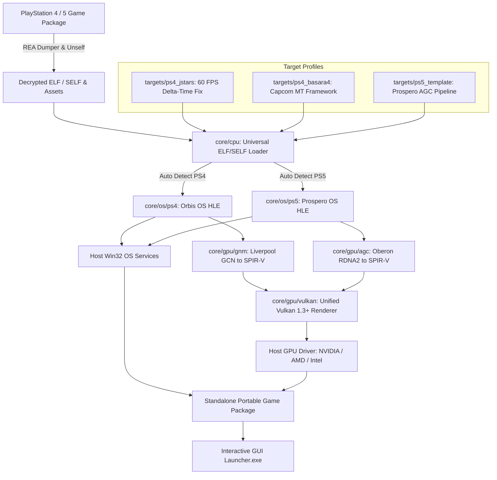

# anyPS: Universal PS4 & PS5 to PC Native Translation Wrapper Architecture

**anyPS** adalah kerangka kerja modular (*translation wrapper*) berkinerja tinggi yang dirancang untuk menerjemahkan dan mengeksekusi biner PlayStation 4 (x86-64 Orbis OS) dan PlayStation 5 (x86-64 Prospero OS) langsung secara *native* di PC Windows x86-64, tanpa *overhead* virtualisasi CPU tingkat penuh (full-system emulation).

---

## 1. Filosofi Arsitektur Universal

Karena arsitektur hardware PS4 (**AMD Jaguar CPU**) dan PS5 (**AMD Zen 2 CPU**) berbasis **x86-64**, instruksi komputasi CPU game dapat langsung dieksekusi secara native oleh prosesor PC modern tanpa penerjemahan instruksi (binary translation / JIT).

Tugas utama **anyPS** adalah:
1. **Memuat (Load & Relocate - `core/cpu/`):** Memetakan segmen ELF/SELF 64-bit game ke virtual address space host, mendeteksi platform target (PS4 vs PS5) secara otomatis, dan membaca metadata versi SDK.
2. **Menjembatani Kernel (Universal HLE OS - `core/os/`):**
   - **`core/os/ps4/`:** Mengimplementasikan antarmuka FreeBSD/Orbis OS syscalls, thread manajemen, sinkronisasi, dan filesystem secara native di Win32.
   - **`core/os/ps5/`:** Mengimplementasikan kernel Prospero OS, unified GDDR6 memory mapping (16 GiB), dan dispatching Zen 2 features.
3. **Menerjemahkan Grafis (Modular Vulkan GPU Core - `core/gpu/`):**
   - Mengonversi perintah rendering AMD Liverpool GNM (PS4) dan AMD Oberon AGC (PS5) ke backend native **Vulkan 1.3+**.
4. **Patching Adaptif (REA Protocol):** Menormalkan delta-time, timestep Havok/engine, dan flip rate agar berjalan 1.0x normal pada framerate 60 FPS atau lebih tinggi.



---

## 2. Struktur Proyek Modular

```
anyPS/
├── CMakeLists.txt            # Root build script (-DPLATFORM=... -DTARGET_GAME=...)
├── core/
│   ├── os/
│   │   ├── os_interface.h    # Kontrak antarmuka OS universal
│   │   ├── ps4/              # HLE Orbis OS: Virtual Memory, Threading, VFS, WASAPI
│   │   └── ps5/              # HLE Prospero OS: 16GB GDDR6, Zen 2, Tempest 3D
│   ├── cpu/
│   │   ├── elf_loader.h      # Universal ELF/SELF header reader & validator
│   │   └── elf_loader.c      # Detektor platform otomatis (PS4 vs PS5)
│   └── gpu/
│       ├── include/          # Kontrak GPU backend & shader translator
│       ├── gnm/              # PS4 Liverpool GNM (GCN -> SPIR-V)
│       ├── agc/              # PS5 Oberon AGC (RDNA 2 -> SPIR-V)
│       └── vulkan/           # Unified Vulkan 1.3+ Renderer & Presenter
├── targets/
│   ├── ps4_jstars/           # Profil referensi terverifikasi: J-Stars Victory VS+ (60 FPS Fix)
│   ├── ps4_basara4/          # Profil target berikutnya: Sengoku Basara 4: Sumeragi
│   ├── ps5_template/         # Kerangka boilerplate untuk target game PS5
│   └── template/             # Template target umum
├── tools/
│   ├── rea_triase.py         # Universal REA binary & SDK triage tool
│   ├── Launcher.cs           # Source launcher GUI C# WinForms asinkron
│   ├── win_build.sh          # Pipeline kompilasi otomatis MSYS2 Clang64
│   └── make_portable.ps1     # Script bundling 99 DLL runtime standalone
└── workspace/                # Direktori kerja lokal untuk dump game (dikecualikan Git)
```

---

## 3. Alur Triage & Kompilasi Modular

### Triage Biner
```bash
python tools/rea_triase.py path/to/eboot.bin
```

### Kompilasi Target
```bash
# Target PS4 J-Stars
cmake -B build -DPLATFORM=ps4 -DTARGET_GAME=jstars
cmake --build build

# Target PS4 Sengoku Basara 4
cmake -B build -DPLATFORM=ps4 -DTARGET_GAME=basara4
cmake --build build

# Target PS5 Template
cmake -B build -DPLATFORM=ps5 -DTARGET_GAME=template
cmake --build build
```
