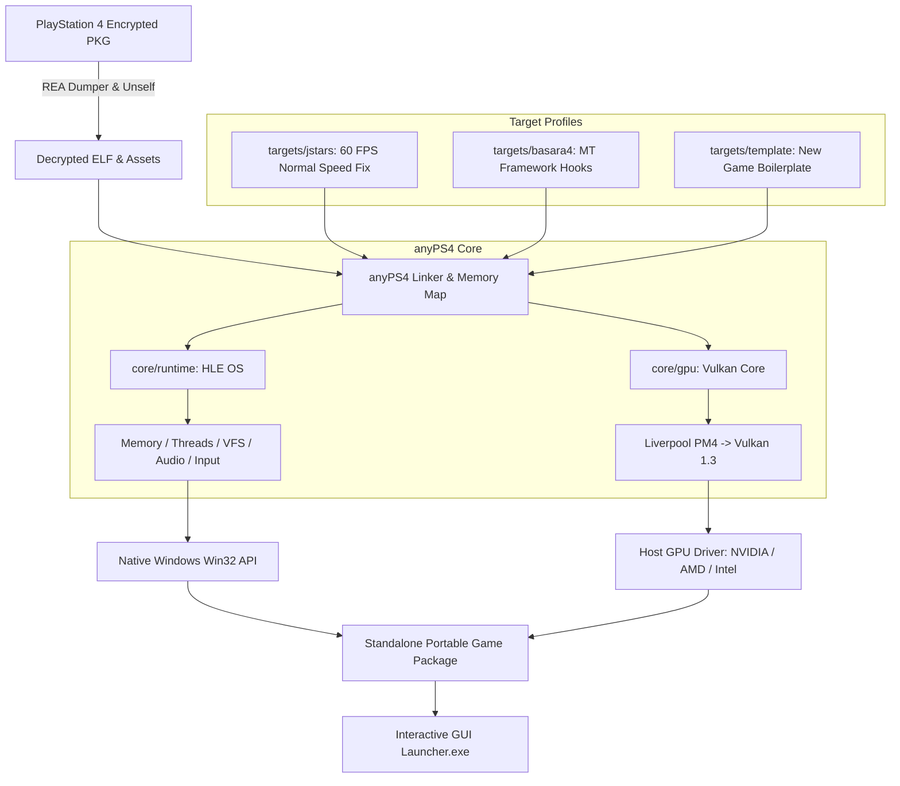

# anyPS4: Modular PS4-to-PC Native Translation Wrapper Architecture

**anyPS4** adalah kerangka kerja modular (*translation wrapper*) berkinerja tinggi yang dirancang untuk menerjemahkan dan mengeksekusi game PlayStation 4 (x86-64 Orbis OS) langsung secara *native* di PC Windows x86-64, tanpa *overhead* virtualisasi CPU tingkat penuh (full-system emulation).

---

## 1. Filosofi Arsitektur

Karena arsitektur hardware PS4 sudah berbasis **x86-64 (AMD Jaguar CPU)** dan **AMD Radeon GCN GPU**, instruksi komputasi CPU game dapat langsung dieksekusi secara native oleh prosesor PC modern tanpa penerjemahan instruksi (binary translation / JIT). 

Tugas utama **anyPS4** adalah:
1. **Memuat (Load & Relocate):** Memetakan segmen ELF 64-bit game ke virtual address space host.
2. **Menjembatani Kernel (HLE Runtime):** Mengimplementasikan antarmuka FreeBSD/Orbis OS syscalls, thread manajemen, sinkronisasi, dan filesystem secara native di Win32.
3. **Menerjemahkan Grafis (Vulkan GPU Core):** Mengonversi perintah rendering low-level AMD Liverpool GNM (PM4 packets) ke Vulkan 1.3+.
4. **Patching Adaptif (REA Protocol):** Menormalkan delta-time, timestep Havok/engine, dan flip rate agar berjalan 1.0x normal pada framerate 60 FPS atau lebih tinggi.



---

## 2. Struktur Proyek Modular

```
anyPS4/
├── core/
│   ├── runtime/              # Universal Orbis OS HLE (Memory, Threads, VFS, Audio, Pad)
│   └── gpu/                  # Liverpool GNM to Vulkan 1.3 translation engine
├── targets/
│   ├── template/             # Kerangka boilerplate untuk target game baru
│   ├── jstars/               # Profil referensi: J-Stars Victory VS+ (60 FPS Fixed)
│   └── basara4/              # Profil target: Sengoku Basara 4: Sumeragi (Capcom MT)
├── tools/                    # Tooling REA, scripts inspeksi ELF, dan automated packager
│   ├── Launcher.cs           # Source code standalone WinForms Launcher
│   ├── make_portable.ps1     # Script otomatis bundling DLL & portable distribution
│   ├── win_build.sh          # Master build script MSYS2 Clang64
│   └── rea_analyzer.py       # Binary triage & GOT inspection
├── workspace/                # Direktori kerja lokal untuk game dump & eboot.bin (Git-ignored)
├── anyPS4.md                 # Dokumen arsitektur blueprint
├── PRD.md                    # Product Requirements Document
├── README.md                 # Dokumentasi umum repositori
└── .gitignore                # Aturan isolasi file hak cipta & build artifacts
```

---

## 3. Prasyarat Lingkungan Pengembangan

- **Sistem Operasi:** Windows 10 / 11 (64-bit)
- **Compiler Suite:** MSYS2 Clang64 (`clang`, `clang++`, `lld`, `ninja`, `cmake`)
- **Graphics API:** Kartu grafis dengan dukungan Vulkan 1.3+ (NVIDIA GeForce, AMD Radeon, Intel Arc)
- **Launcher Compiler:** .NET Framework 4.8 (`csc.exe` bawaan Windows di `C:\Windows\Microsoft.NET\Framework64\v4.0.30319\csc.exe`)

---

## 4. Alur Kerja Porting (Workflow)

1. **Extract & Triage:** Ekstrak file game ke folder `workspace/` menggunakan script ekstraksi.
2. **Select Target:** Pilih folder target di `targets/` atau gunakan `targets/template/`.
3. **Patch Analysis:** Lacak konstanta frame timer dan *flip rate* menggunakan protokol REA.
4. **Compile:** Jalankan `./tools/win_build.sh` di lingkungan MSYS2 Clang64.
5. **Bundle:** Jalankan `powershell -File tools/make_portable.ps1` untuk menghasilkan paket standalone siap main.

---

## 5. Disclaimer Hukum & Hak Cipta

> **PENTING:**
> Proyek **anyPS4** adalah perangkat lunak sumber terbuka yang dikembangkan secara independen untuk tujuan edukasi, interoperabilitas, dan preservasi digital.
> 
> Repositori ini **TIDAK** mendistribusikan, menyertakan, atau mengunduh aset game komersial berhak cipta, file BIOS resmi, kunci dekripsi, maupun binary milik Sony Interactive Entertainment atau pihak ketiga.
> 
> Pengguna wajib menyediakan dan menggunakan salinan game resmi (*game dump*) yang diperoleh secara legal dari konsol PlayStation 4 milik pribadi.
